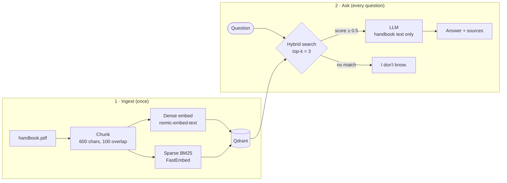

# Clause

A customer-support assistant, built with RAG (Retrieval-Augmented Generation). It runs locally with Ollama by default.

Ask a question and Clause looks it up in the handbook. It answers only from what it finds and returns the sources it used. If the handbook doesn't cover the question, it says "I don't know."

## How it works



> Expand a step below for details and links to the code.

<details>
<summary><b>1. Load and chunk the handbook</b></summary>

`PyPDFLoader` reads the PDF page by page. `RecursiveCharacterTextSplitter` cuts it into ~600-character chunks with 100 characters of overlap, preferring paragraph and line breaks, so a sentence that answers a question is rarely split in half.

Code: [`ingestion.py`](api/app/services/ingestion.py) · Settings: `RAG_CHUNK_SIZE`, `RAG_CHUNK_OVERLAP`
</details>

<details>
<summary><b>2. Embed twice: dense + sparse</b></summary>

Each chunk gets two vectors:

| Vector | Model | Good at |
|---|---|---|
| Dense | `nomic-embed-text` (Ollama, 768-dim) | Meaning: "send it back" ≈ "return policy" |
| Sparse | BM25 (FastEmbed) | Exact terms: prices, day counts, product names |

Before the old collection is deleted, ingestion checks the embedding model actually returns `RAG_EMBED_DIM` dimensions, so a bad config can't wipe the index.
</details>

<details>
<summary><b>3. Store in Qdrant</b></summary>

Both vectors go into one Qdrant collection (`dense` with cosine distance, `sparse` for BM25). It runs embedded on disk at `./vector_stores` by default, or against a server if `RAG_QDRANT_URL` is set.
</details>

<details>
<summary><b>4. Hybrid search</b></summary>

The question is embedded the same two ways, Qdrant fuses the dense and BM25 results, and the top 3 chunks are kept. Anything under the score threshold (0.5) is dropped. If nothing survives, Clause answers `"I don't know."` **without calling the LLM at all**.

Code: [`chat.py`](api/app/services/chat.py) · Settings: `RAG_TOP_K`, `RAG_SCORE_THRESHOLD`
</details>

<details>
<summary><b>5. Grounded answer</b></summary>

The retrieved chunks are passed to the chat model as "Handbook text", with a system prompt that tells it to answer only from that text, copy numbers exactly, keep it to one or two sentences, and reply `"I don't know."` if the text doesn't answer the question.

The response includes the answer plus each source's file, page and score (example values):

```json
{
  "answer": "Repairs normally take 5 to 10 working days.",
  "sources": [{ "source": "files/shop_handbook.pdf", "page": 1, "score": 0.82 }]
}
```

Prompt: [`config.py`](api/app/core/config.py)
</details>

<details>
<summary><b>6. Evals</b></summary>

A golden test set ([`golden.jsonl`](api/evals/golden.jsonl)) measures retrieval hit rate, answer correctness, refusals and leaks of staff-only information. Run it with `uv run python -m evals.run`; results land in `api/evals/results/`.
</details>

## Project layout

| Folder        | What it holds                                                  |
|---------------|----------------------------------------------------------------|
| `api/`        | FastAPI RAG backend (LangChain + Ollama + Qdrant), evals, agent prototype |
| `web/`        | Frontend (coming soon)                                         |
| `notebooks/`  | Step-by-step learning notebooks (local only, not tracked)      |
| `playground/` | Standalone RAG experiments (local only, not tracked)           |

## Quick start

```bash
ollama pull qwen3.5:4b
ollama pull nomic-embed-text

cd api
uv sync
cp .env.example .env
uv run python -m app.services.ingestion   # build the vector store
uv run fastapi dev app/main.py            # start the API
```

Then open http://127.0.0.1:8000/docs and try `POST /ask`.

To measure answer quality, run `uv run python -m evals.run` (stop the API first).

See [`api/README.md`](api/README.md) for endpoints, configuration, evals and the CLI.
